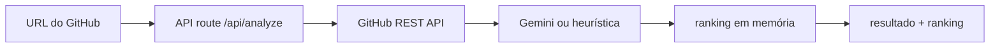

# RepoScore — avaliação exploratória de repositórios

Aplicação Next.js que recebe uma URL do GitHub, coleta metadados públicos e produz notas para ideia, README e stack usando Gemini ou uma heurística local.

**Estado:** MVP funcional no código, sem persistência durável, autenticação, testes ou deploy verificado. O ranking vive apenas na memória do processo e é perdido ao reiniciar.

## Fluxo



O score final usa:

```text
ideia 40% + README 30% + stack 30%
```

Sem `GEMINI_API_KEY`, a aplicação usa regras baseadas em tamanho do README, linguagens, tamanho do repositório, descrição, estrelas e número aproximado de commits.

## Executar

Pré-requisitos: Node.js e npm.

```bash
npm ci
npm run dev
```

Variáveis opcionais:

```dotenv
GITHUB_TOKEN=token_server_side_para_aumentar_limite_da_API
GEMINI_API_KEY=chave_server_side_do_gemini
```

Abra `http://localhost:3000` e informe uma URL pública no formato `https://github.com/owner/repo`.

## O que é realmente analisado

- metadados do repositório;
- até 4.000 caracteres do README;
- bytes por linguagem;
- tamanho, estrelas, forks e contagem aproximada de commits.

O código não clona nem lê a árvore completa. Portanto a nota não mede qualidade interna, testes, segurança, arquitetura ou correção funcional do projeto.

## Verificações

```bash
npm run lint
npm run build
```

Não há suíte automatizada. Node.js não estava disponível na auditoria local, então build e lint não foram reexecutados.

## Limitações

- avaliações por LLM são subjetivas e podem variar;
- o fallback favorece volume e popularidade, apesar da proposta de não medir popularidade;
- a URL aceita sufixos adicionais depois de `owner/repo`, que merecem validação mais estrita;
- não há rate limiting, cache, timeout explícito ou proteção contra abuso da API;
- a persistência Supabase citada em `blueprint.md` não foi implementada;
- não há explicação detalhada ou evidência para justificar cada nota;
- repositórios privados não são suportados de forma segura.

O projeto deve ser apresentado como experimento de UX e integração de APIs, não como avaliação objetiva do valor de software.
